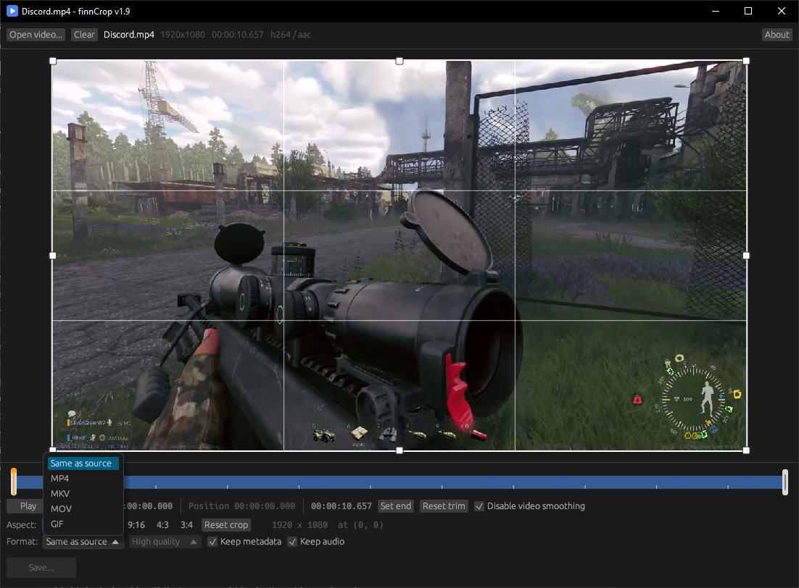
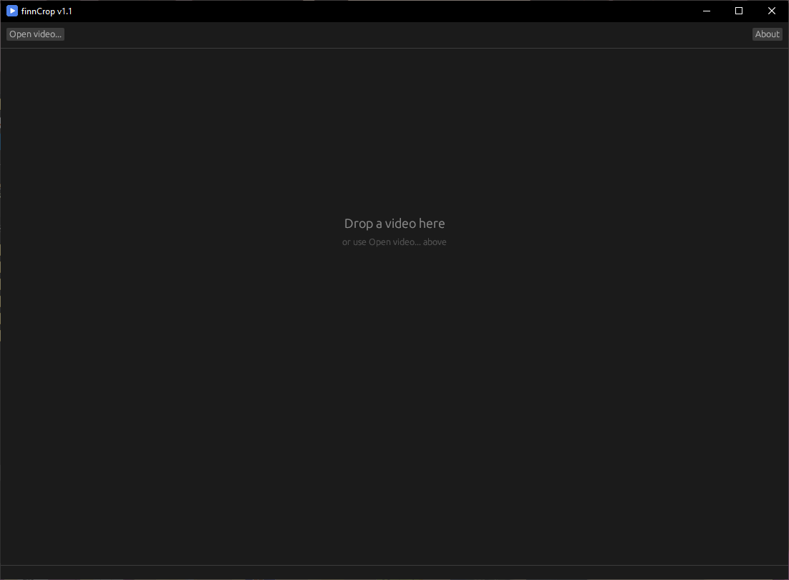

<div align="center">


# finnCrop

**Crop a region of a video and cut it - exactly where you asked.**


</div>



## About

finnCrop is a video cropper that does not ask you to run a command line. Drop a
file on the window, drag the crop box, set the two ends of the trim, press Save.

What makes it worth having is what happens next. The cut starts and ends exactly
where the trim says, to the frame, whatever the file. The picture is re-encoded
with x264 and the audio is copied untouched wherever the container allows it,
so only what has to change does.

It is also one file. FFmpeg and ffprobe travel inside the exe and are unpacked
once to `%LOCALAPPDATA%\finnCrop\ffmpeg\1.8\`, so there is no installer, no
admin rights, and no DLL sitting beside it.

## Download

[finnCrop.exe](https://github.com/finnuen/finnCrop/releases/latest) — 204 MB, 64-bit Windows 10 or 11.

Nothing to install: put it wherever you keep programs and run it. The first
start takes a few seconds longer than the ones after it, because about 205 MB
has to be unpacked and virus-checked. Deleting that `%LOCALAPPDATA%` folder is
harmless — it is written again on the next start.

## How to use

<div align="center">

</div>

1. **Drop a video on the window**, or click *Open video…*. **Clear**, to its
   right, closes the file and goes back to the empty window; it is dimmed while
   no file is open.
2. **Crop** — drag the box or its handles. Aspect presets: 1:1, 16:9, 9:16, 4:3, 3:4.
   Scroll over the picture to zoom in and out, and middle-drag to pan a zoomed
   one. *Disable video smoothing* is on to start with: the preview is drawn as
   whole pixels, like the picture actually is, and the crop edges land on whole
   pixels too. Neither is saved: the file is what the box says, smoothed or not.
3. **Trim** — drag the two handles on the timeline, or use *Set start* / *Set end*.
   Click or drag the bar to move the preview frame; <kbd>←</kbd> and <kbd>→</kbd>
   step one frame at a time.
4. **Play** (or <kbd>Space</kbd>) plays from the playhead to the end of the trim.
   With a crop set it plays the crop and nothing else, so what is on screen is
   what will be in the file. It pauses with *Pause*, <kbd>Space</kbd>, or a click
   on the picture, and moving the playhead stops it. Playback is silent — it is
   there to judge the crop and the cut, not to replace a media player.
5. **Save…** — the original file is never overwritten.

## Modes

The mode is picked for you and shown under the controls:

| Mode | When | What it does |
| --- | --- | --- |
| **Cut** | always | picture re-encoded with x264, audio copied unless *Keep audio* is off (converted to AAC in MKV), quality selectable |
| **Crop** | the box is smaller than the frame | the same, plus the picture is cropped |
| **GIF** | format *GIF* | re-encoded to a palette, loops forever, no sound, no metadata |

## Notes

- **A cut is exact.** It begins and ends on the frames the trim points at,
  whatever the file. That costs a re-encode of the picture: a lossless copy
  cannot start anywhere except on a keyframe, and keyframes can be seconds
  apart, which would make the clip longer than the range you selected.
- **GIF quality moves three things at once** — frame rate (15 / 12 / 10 fps),
  long side (800 / 640 / 480 px) and palette (256 / 192 / 128 colours). The
  picture is only ever made smaller, never bigger. A GIF is encoded in two
  passes, one to build the palette from the whole clip and one to encode it, so
  it takes about twice as long as a crop.
- **Codecs.** If the source codecs cannot be copied into the chosen container —
  some AVI or WMV audio into MP4, for instance — the app says so. Choose MKV, or
  *Same as source*.
- **Keep audio off** writes the file without an audio track at all, not a silent one.
  With nothing else changed the picture is remuxed rather than re-encoded.
- **Keep metadata OFF** removes tags (title, creation date, GPS, encoder name)
  and chapters. With nothing else changed it just remuxes, so it stays lossless.
  When the picture is re-encoded the x264 settings string is removed with it.
- **Opus and Vorbis in MP4.** The container allows them; most Windows players do
  not, and open the file to a still frame. When the output is MP4 or MOV the
  audio is converted to AAC instead, and the controls say so. MKV carries them
  as they are.
- **Subtitles and extra video streams are not copied** — first video plus all
  audio only.

## Licence

[Apache License 2.0](LICENSE) — Copyright 2026 finnuen. The licence text is built
into the program as well, under *About*.

FFmpeg is **not** covered by that licence. It is packed in under the GNU GPL v3
and runs as a separate process, which is what keeps the program itself Apache 2.0.
The build pins FFmpeg 9.0.2 and checks its SHA256, the licence text travels with
the exe, and the exact corresponding source is named in
[THIRD-PARTY.md](THIRD-PARTY.md) — which also covers the fonts the UI toolkit
embeds.

## Build from source

Rust with the `x86_64-pc-windows-gnu` toolchain:

```powershell
.\build.ps1                 # release build, version bumped (1.8 -> 1.9)
.\build.ps1 -Debug          # debug build, fast, ffmpeg read from vendor\
.\build.ps1 -KeepVersion    # rebuild the same version
.\build.ps1 -Version 2.0    # set the version outright
```

`Cargo.toml` holds the version and nothing else does; the script writes it into
the build's name, the exe's version block, the title bar and the About window.
The result is `dist\finnCrop_v1.8.exe`, about 205 MB with FFmpeg inside.

The first build downloads FFmpeg once (about 110 MB), from the one pinned 9.0.2
package, and packs it into the executable. The download is checked against a
fixed SHA256 before it is unpacked, so a rebuild of the same version really does
carry the same binaries. The script looks for cargo in `%USERPROFILE%\.cargo\bin`
itself, so a rustup install that left that folder off PATH is still fine.

Tests use the `vendor\` copies:

```powershell
cargo test
```

## The icon

The artwork is drawing code, not a bitmap: [`tools/IconDraw.ps1`](tools/IconDraw.ps1)
holds the geometry and [`tools/make-icon.ps1`](tools/make-icon.ps1) renders
`src/app-icon.png`, `src/app.ico` and the window icon from it. The large sizes
are a crop frame around a play triangle; 32 px and below are one big triangle,
because the frame's stroke is thinner than a pixel there.

```powershell
powershell -ExecutionPolicy Bypass -File tools\make-icon.ps1
```
